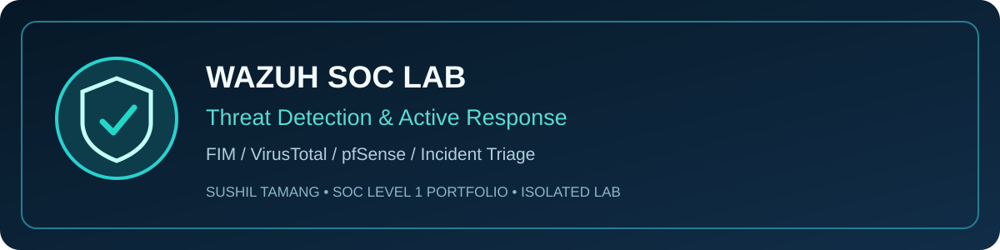
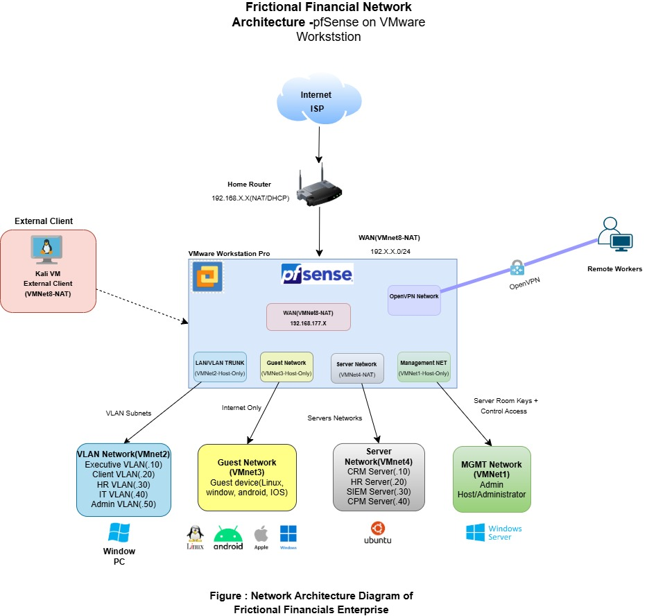
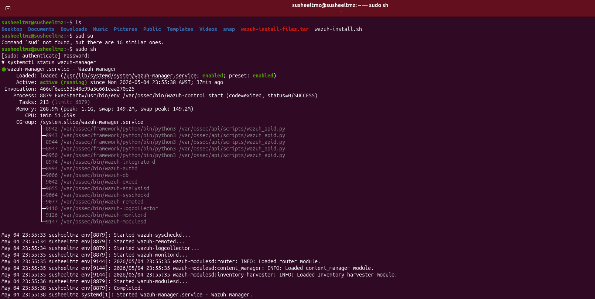
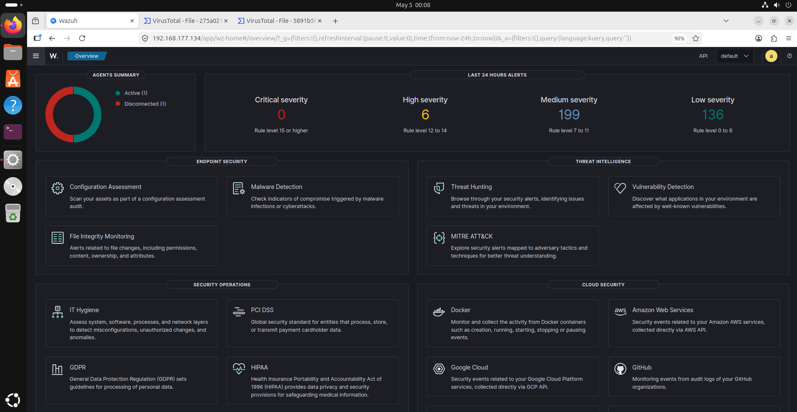
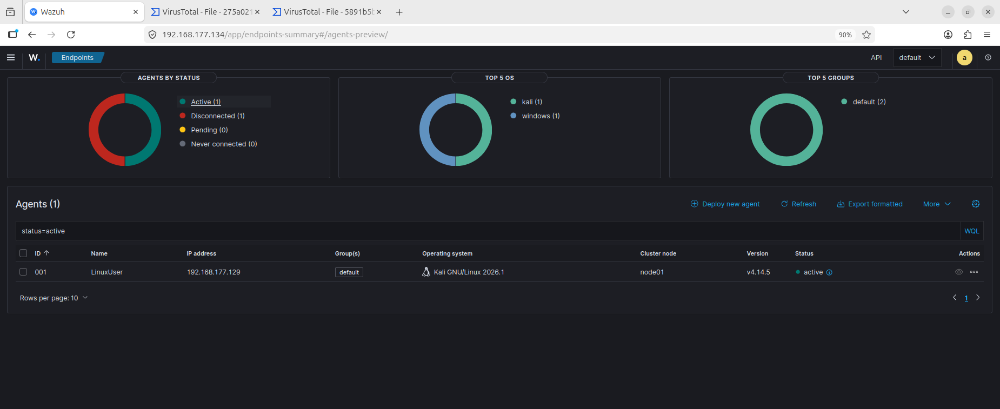
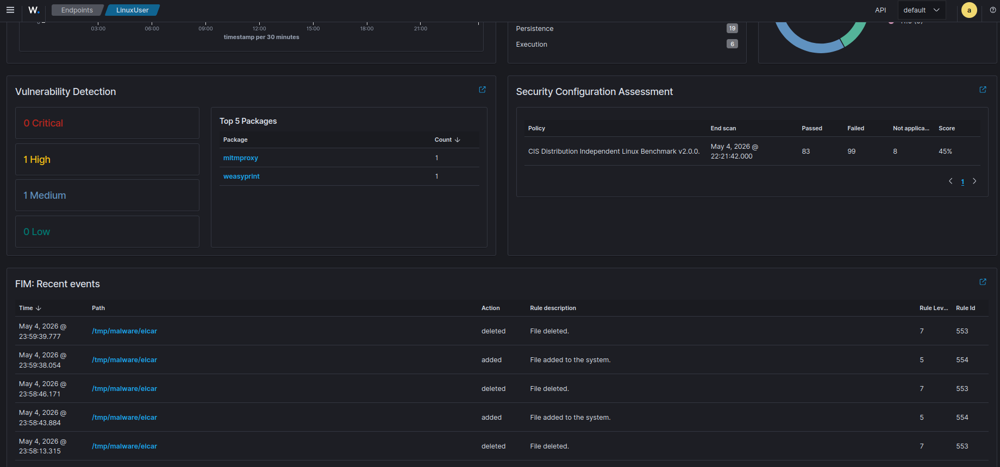
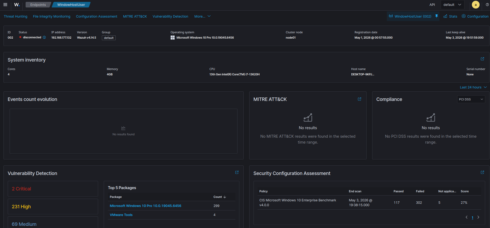
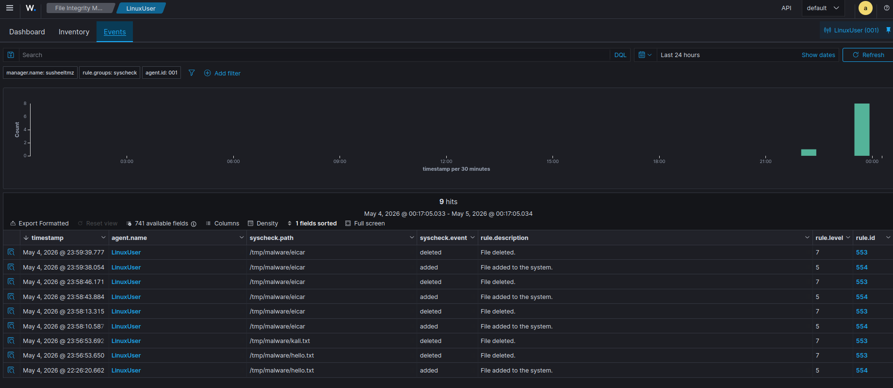
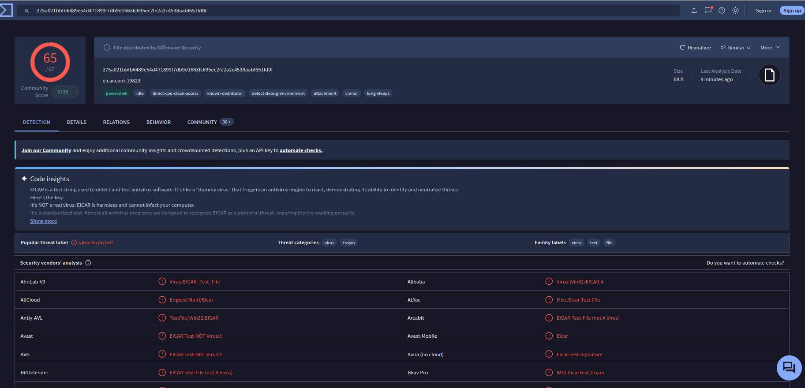
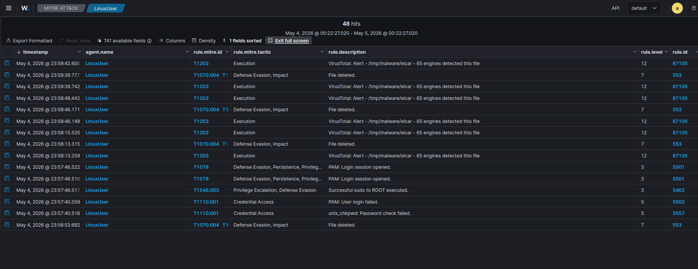

# 🛡️ Automated Threat Detection & Active Response SOC Lab

### Wazuh SIEM × VirusTotal × pfSense × VMware

**Sushil Tamang** · Cybersecurity Portfolio · Perth, Western Australia

[Main GitHub Profile](https://github.com/Ryalghost-SusheelTmz) · [LinkedIn](https://www.linkedin.com/in/sushiltamang10/)

---

## 📖 Project overview

I built a **simulated financial-enterprise security monitoring environment** using VMware Workstation Pro, pfSense and Wazuh. The objective was to bring together endpoint telemetry, **File Integrity Monitoring (FIM)**, **VirusTotal enrichment**, MITRE ATT&CK event mapping, security configuration assessment and a **custom Wazuh Active Response script**.

For the detection-and-response test, I used the **EICAR anti-malware test file**. EICAR is a harmless, industry-standard antivirus test string—not real malware. The test allowed me to trace a file through **creation → FIM alert → VirusTotal detection → Active Response → removal event** in a controlled environment.

This write-up is grounded in original screenshots from **4–5 May 2026**. It documents what those screenshots show, including cases where an agent was disconnected. The screenshots support the observed response chain; they do not by themselves establish an independent end-to-end latency benchmark.

### Skills demonstrated

| SOC Level 1 competency | Evidence in this lab |
|---|---|
| Security monitoring | Wazuh manager, endpoint inventory and severity dashboard |
| Alert triage | FIM events and VirusTotal rule 87105 |
| Event correlation | Rule 554 (added), rule 553 (deleted), rule 657 (Active Response event) |
| Threat intelligence | File hash reputation from VirusTotal; 65/67 detections in the captured result |
| Initial incident response | Configured local \`remove-threats.sh\` Active Response execution |
| Security posture review | Linux and Windows CIS-based SCA and vulnerability findings |
| Investigation documentation | Timestamped evidence, rule IDs, host status and ATT&CK fields |

## 🧩 Lab environment and technology

| Component | Configuration / purpose |
|---|---|
| VMware Workstation Pro | Hypervisor for isolated laboratory systems |
| pfSense | Segmentation, NAT/firewall policy and OpenVPN in the network design |
| Wazuh 4.14.5 | Centralized detection, FIM, dashboard, security assessment and Active Response |
| LinuxUser (agent 001) | Kali GNU/Linux 2026.1; shown **active** during the captured test |
| WindowHostUser (agent 002) | Windows 10 Pro; shown **disconnected** in the captured endpoint inventory |
| VirusTotal | Hash-reputation enrichment for monitored files |
| EICAR | Harmless standardized test file to exercise the detection pipeline |
| Bash / jq / Wazuh Active Response | Custom script and manager configuration for local response |

> **Original screenshots:** The numbered figures below correspond to files in the accompanying screenshot-upload package. Once the images are uploaded under \`screenshots/\`, they render in their exact positions here. The screenshots were supplied by the project author, not synthetically generated.

---

## 🏗️ Step-by-step implementation and investigation

### 01 — Design the enterprise-style network with VMware and pfSense

I designed a segmented network for a fictional financial enterprise. The diagram shows **VMnet8 NAT/WAN**, a **VMnet2 LAN/VLAN trunk**, a **VMnet3 guest network**, a **VMnet4 server network**, and a **VMnet1 management network**. pfSense is placed at the boundary, with an OpenVPN path shown for remote-access users.

The design separates user, guest, server and administrative traffic to reduce unnecessary lateral connectivity and help centralize monitoring. The diagram represents the documented network architecture; individual firewall policy tests are not separately evidenced by this image.

*Figure 1 — Original Kaplan Financials enterprise lab architecture diagram.*

### 02 — Install Wazuh and verify the manager service

I deployed the Wazuh manager on a Linux server and inspected its service health with:

~~~bash
sudo systemctl status wazuh-manager
~~~

The captured service output shows **\`wazuh-manager.service\` active (running)**, including manager processes for analysis, remote communication, log collection, monitoring and modules.

*Figure 2 — Wazuh manager status captured on 4 May 2026.*

### 03 — Verify the Wazuh security overview

I used the dashboard to review the endpoint summary and current alert-severity distribution. The overview screenshot shows **one active and one disconnected agent**, plus **0 critical, 6 high, 199 medium and 136 low alerts** in the selected 24-hour view.

These counts describe a dashboard snapshot and should not be interpreted as a production incident count.

*Figure 3 — Security operations overview and severity distribution.*

### 04 — Enroll and check the Linux endpoint

The endpoint inventory shows **agent 001, LinuxUser**, using **Kali GNU/Linux 2026.1**, assigned to the default group, connected to Wazuh **v4.14.5** and showing **Active** status. This was the endpoint used for the visible FIM and VirusTotal alert investigation.

The same inventory shows **one disconnected agent**; it would be inaccurate to claim both endpoints were healthy at that moment.

*Figure 4 — Endpoint list showing the connected LinuxUser agent.*

### 05 — Inspect Linux and Windows security posture

I examined vulnerability information and security configuration assessment outcomes for the monitored systems.

**Linux endpoint snapshot:** 0 critical, **1 high**, **1 medium**, 0 low vulnerabilities; the **CIS Distribution Independent Linux Benchmark v2.0.0** assessment shows **83 passed, 99 failed, 8 not applicable**, and **45%** score.

**Windows endpoint snapshot:** **WindowHostUser (002)**, Windows 10 Pro, Wazuh v4.14.5, was **disconnected** at capture time. Its historical inventory shows **2 critical and 231 high vulnerability findings** in the visible portion, and a **CIS Windows 10 assessment of 117 passed, 302 failed, 5 not applicable**, with **27%** score. These are assessment snapshots, not current remediation confirmation.

*Figures 5–6 — Actual security posture data from the Linux and Windows dashboard views.*

### 06 — Configure and investigate File Integrity Monitoring

I monitored the Linux endpoint's file activity and reviewed **Wazuh syscheck (FIM)** events. The captured event table records activity under \`/tmp/malware/\`, including \`eicar\`, \`hello.txt\` and \`kali.txt\`.

The visible alerts show **rule 554** for a file being added (level 5) and **rule 553** for a file being deleted (level 7). For instance, the EICAR file appears as **added at 23:59:38.054** and **deleted at 23:59:39.777** on 4 May 2026, according to the dashboard timestamps.

*Figure 7 — Actual FIM event history for the LinuxUser endpoint, with paths, timestamps and rule IDs.*

### 07 — Enrich the test-file alert using VirusTotal

Wazuh's VirusTotal integration checked the hash of the EICAR file. The corresponding VirusTotal page shows the SHA-256 hash beginning \`275a021bbfb6489e...\`, with **65 of 67** scanning engines flagging the standardized EICAR test signature.

This result verifies antivirus-test-string recognition in the captured lookup. It does **not** mean an authentic malicious infection occurred.

*Figure 8 — VirusTotal detection view for the EICAR test file.*

### 08 — Configure the custom Active Response command

On the Wazuh manager, I configured the custom response command **\`remove-threats\`** in \`/var/ossec/etc/ossec.conf\`, referencing **\`remove-threats.sh\`** under \`/var/ossec/active-response/bin/\`.

The configuration screenshot shows a **local** Active Response associated with **VirusTotal alert rule \`87105\`**, using the following XML structure:

~~~xml
<command>
  <name>remove-threats</name>
  <executable>remove-threats.sh</executable>
  <timeout_allowed>no</timeout_allowed>
</command>

<active-response>
  <disabled>no</disabled>
  <command>remove-threats</command>
  <location>local</location>
  <rules_id>87105</rules_id>
</active-response>
~~~

The screenshot also shows the script reading JSON alert data, extracting a source-file path using \`jq\`, checking the Active Response command flow and writing to an Active Response log. This code and configuration were used in a **controlled lab**. Unrestricted file deletion should not be carried into a production environment without strict validation, allowlisting and authorization.

*Figures 9–10 — Original ossec.conf Active Response configuration and remove-threats.sh script view.*

### 09 — Correlate FIM, VirusTotal and Active Response events

In **Threat Hunting**, I correlated the alerts affecting **LinuxUser** to establish their order and relationship. The captured timeline includes:

| Recorded time — 4 May 2026 | Observed event | Wazuh rule |
|---|---|---|
| 23:59:38.054 | EICAR file **added** | **554** |
| 23:59:39.742 | VirusTotal reports **65 engine detections** | **87105** |
| 23:59:39.777 | EICAR file **deleted** | **553** |
| 23:59:40.541 | Active Response execution logged | **657** |

The threat-hunting view also contains later VirusTotal/Active Response events for repeated testing. The event chronology supports a rapid response sequence, but Wazuh alert timestamps alone are not a fully instrumented end-to-end latency test.

*Figure 11 — Correlated events from FIM, VirusTotal and Active Response.*

### 10 — Review response evidence and MITRE ATT&CK mapping

The Active Response event document shows the program **\`active-response/bin/remove-threats.sh\`**, rule **657** and the logged message **“Successfully removed threat.”** Together with the FIM deletion event, this provides evidence that the configured response path executed during the EICAR test. The log message does not by itself verify unrelated files or endpoints.

The MITRE ATT&CK view includes **T1203** beside the VirusTotal alerts and **T1070.004** beside file-deletion events. These are the **mappings recorded by Wazuh** for the captured events, not proof that exploitation or malicious defense evasion actually took place.

*Figures 12–13 — Original successful-response log and associated ATT&CK-tagged events.*

---

## 📊 Observed results

| Category | Outcome documented by the original screenshots |
|---|---|
| Manager service | Wazuh service **active (running)** |
| Endpoint monitoring | LinuxUser **active**; WindowHostUser **disconnected** at captured time |
| File integrity | EICAR create and delete activity captured by FIM rules 554/553 |
| Threat intelligence | VirusTotal showed **65/67** detections on the EICAR test file |
| Alert correlation | VirusTotal alert rule **87105**, response event rule **657** |
| Custom response | Wazuh log reports **“Successfully removed threat”** |
| Configuration assessment | Linux 45% and Windows 27% in the captured CIS assessments |
| MITRE mapping | Wazuh displayed T1203 and T1070.004 in the monitored alert view |

**Response-time qualification:** My original project notes report a response in **under two seconds** during controlled testing. These screenshots illustrate individual events and their timestamps, but do not independently establish a repeatable, full detection-to-removal performance measurement.

## 🎯 SOC Analyst Level 1 lessons

This lab strengthened my ability to **follow an alert from its initial signal to supporting logs and response evidence**, interpret threat-intelligence results critically, examine security configuration weaknesses, understand endpoint availability, and document a clear investigative timeline. My goal is to apply that evidence-first approach to **entry-level SOC monitoring, triage and escalation**.

## 📁 Project documentation

- [Wazuh installation and configuration steps](docs/SETUP.md)
- [Active Response configuration and observed workflow](docs/ACTIVE_RESPONSE.md)
- [Investigation findings](docs/INVESTIGATION.md)
- [Validation and evidence interpretation](docs/VALIDATION.md)
- [Troubleshooting notes](docs/TROUBLESHOOTING.md)
- [Vendor references](docs/REFERENCES.md)
- [Screenshot index and captions](screenshots/README.md)

## 🔐 Responsible testing

This project was conducted as an educational, authorized cybersecurity lab. **EICAR is a harmless anti-malware test file**. SIEM severity labels, antivirus detections and MITRE ATT&CK tags require analyst interpretation; they do not independently prove a real compromise. Scripts that remove files should be isolated, scoped, reviewed and tested before any use outside a lab.

---

**Detect → Validate → Enrich → Respond → Document**

*SOC Level 1 portfolio | Sushil Tamang*

[GitHub](https://github.com/Ryalghost-SusheelTmz) · [LinkedIn](https://www.linkedin.com/in/sushiltamang10/)

