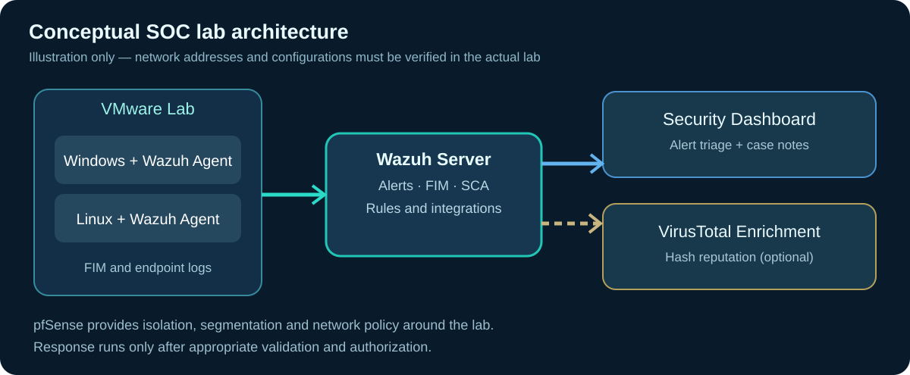
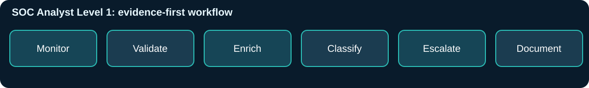

<div align="center">


# 🛡️ Automated Threat Detection & Active Response SOC Lab

**Wazuh SIEM · pfSense · VMware · VirusTotal · File Integrity Monitoring · MITRE ATT&CK**

[](https://github.com/Ryalghost-SusheelTmz)


**Sushil Tamang | Aspiring SOC Analyst (Level 1) | Perth, Australia**

</div>

---

## 📌 Project overview

This project documents my hands-on **simulated financial-enterprise SOC lab**. I used **VMware**, **pfSense**, **Wazuh**, and monitored **Windows and Linux endpoints** to practise detecting, investigating, and responding to endpoint-security activity. I also integrated VirusTotal threat intelligence and explored File Integrity Monitoring (FIM), vulnerability assessment, CIS-based security checks, and MITRE ATT&CK mapping.

In my original controlled lab, a custom Active Response workflow was reported to remove a test malicious file in **under two seconds**. That is a single lab observation, **not an independently reproduced benchmark** and not an indication of production response performance.

> **Evidence and provenance:** This repository provides a documented reconstruction and educational sample code based on my résumé project. The diagrams are *conceptual*, scripts are *new demonstration examples*, and there are **no fabricated screenshots, SIEM results, or test metrics**. Add genuine redacted screenshots and the original script before claiming they are available here.

### Why this is relevant to a Level 1 SOC role

| SOC analyst responsibility | Practice in this project |
|---|---|
| Monitor security alerts | Review Wazuh agent/FIM and integration events |
| Initial triage | Identify host, alert time, path, rule, hash and action |
| Validate a suspected threat | Compare raw activity with alert details and known-safe baselines |
| Enrich an alert | Review VirusTotal context and MITRE ATT&CK technique mapping |
| Investigate impact | Check scope across files, affected endpoints and user context |
| Escalate accurately | Prepare evidence, confidence assessment and recommended next action |
| Document outcomes | Produce investigation notes and an incident timeline |

## 🗺️ Conceptual architecture



*The architecture image is illustrative. Confirm the exact VM topology, IP ranges, Wazuh versions and interfaces against your own lab before documenting them as deployed facts.*

**Data flow:** Windows/Linux endpoint → Wazuh agent → Wazuh server → security dashboard → analyst triage → optional enrichment and controlled response. pfSense provides the segmented lab network and VPN capabilities rather than acting as a Wazuh agent.

## 🎯 Project objectives

1. Design an isolated network that resembles an organization with security monitoring requirements.
2. Deploy and connect Wazuh monitoring for Windows and Linux endpoints.
3. Configure FIM in a **designated test directory** and observe create/modify/delete events.
4. Correlate file alerts with endpoint identity, timestamp, hash and rule context.
5. Use VirusTotal only as an enrichment input, not as an automatic verdict.
6. Demonstrate a *reviewable* response workflow and measure latency appropriately.
7. Capture evidence and write a clear Level 1 SOC escalation summary.

## 🧰 Technology stack

| Component | Role |
|---|---|
| **Wazuh** | Centralized SIEM/XDR-style monitoring, FIM, security assessments and alerts |
| **VMware** | Isolated virtual machines for reproducible lab exercises |
| **pfSense** | Firewalling, segmentation and network policy experiments |
| **Windows / Linux VMs** | Monitored assets and benign event-generation targets |
| **VirusTotal** | Reputation/enrichment for observed file hashes |
| **MITRE ATT&CK** | Organizing suspicious behaviors into an investigation framework |
| **CIS SCA** | Identifying potential configuration hardening gaps |
| **Python / Bash** | Educational FIM event generation and dry-run response simulation |

## 🚀 Reproduce the lab

The most useful starting point is the **[step-by-step build guide](docs/SETUP.md)**, which covers prerequisites, VM isolation, networking, Wazuh deployment, FIM collection, optional VirusTotal enrichment, validation and rollback.

| Step | What you will do | Evidence to collect |
|---|---|---|
| **01 — Network** | Build VMware lab network and pfSense boundaries | Topology and firewall screenshots |
| **02 — Monitoring** | Deploy Wazuh and connect two example agents | Agent health and inventory |
| **03 — Detection** | Configure FIM on a harmless test directory | File create/modify/delete alerts |
| **04 — Enrichment** | Optionally integrate VirusTotal | Enrichment output with secrets redacted |
| **05 — Analysis** | Classify an alert using an L1 triage worksheet | Written case notes |
| **06 — Response** | Exercise dry-run and a carefully authorized response | Response logs and before/after evidence |
| **07 — Review** | Measure time and evaluate limitations | Repeat-run measurements and findings |

**Start here:** [docs/SETUP.md](docs/SETUP.md) · [docs/VALIDATION.md](docs/VALIDATION.md) · [docs/TROUBLESHOOTING.md](docs/TROUBLESHOOTING.md)

## 🔍 Detection and investigation scenario

**Scenario:** A benign, uniquely named text file is created and modified in a watched endpoint directory. The Wazuh agent generates FIM telemetry, and a trainee analyst determines whether the event represents expected lab testing.

The correct first response is **not** to delete a file based on one event. The analyst verifies the alert and context, checks for related activity, documents the known-safe test, and explains what would warrant escalation.



See **[Example L1 investigation](docs/INVESTIGATION.md)** for a documented investigation worksheet, an example narrative, and an escalation template.

## 📁 Repository structure

```text
wazuh-active-response-soc-lab/
├── README.md
├── .gitignore
├── assets/
│   ├── banner.svg                 # Original conceptual banner graphic
│   ├── architecture.svg           # Conceptual lab topology
│   └── triage-workflow.svg        # Analyst workflow illustration
├── config/
│   ├── agent-fim-4x.xml           # Wazuh 4.x FIM sample fragment
│   └── virustotal-manager-4x.xml # Wazuh 4.x integration sample fragment
├── scripts/
│   ├── generate_fim_events.sh     # Benign Linux test activity
│   └── simulate_response.py       # OFFLINE simulation; no deletion
├── tests/
│   └── test_simulate_response.py  # Standard-library unit tests
├── docs/
│   ├── SETUP.md
│   ├── INVESTIGATION.md
│   ├── VALIDATION.md
│   ├── TROUBLESHOOTING.md
│   └── REFERENCES.md
└── screenshots/
    └── README.md                 # Real screenshot checklist and guidelines
```

## 🧪 Reproducible examples

**Generate harmless FIM activity on a dedicated Linux test agent:**

```bash
bash scripts/generate_fim_events.sh
```

Ensure the test directory has been configured in your agent's FIM settings first. This script touches *only* a designated harmless directory, and you should verify changes in Wazuh.

**Test the offline response simulation:**

```bash
python3 -m unittest discover -s tests -v
python3 scripts/simulate_response.py --example
```

The sample response simulation does **not** delete or quarantine anything and is **not** wired into Wazuh Active Response automatically. Wiring a live response script requires version-specific protocol handling, access controls, a response approval decision and additional tests. Wazuh's active-response contracts differ across versions; confirm the version you installed.

## 📊 Findings and evidence

| Observation | Status | Notes |
|---|---|---|
| Wazuh agent visibility in original lab | Described in résumé | Upload genuine screenshot before listing specifics |
| FIM alerts / file hashes | Described in résumé | Add sanitized event exports |
| VirusTotal enrichment | Described in résumé | API key must **never** be shared |
| CIS SCA / vulnerability review | Described in résumé | Add verified findings, scope and mitigation |
| Response under 2 seconds | Reported controlled-lab result | Measurement method and original evidence pending |
| Safe offline simulation supplied here | Example code | Validate locally using included tests |

A measurement template and evidence standards are included in [docs/VALIDATION.md](docs/VALIDATION.md) and [screenshots/README.md](screenshots/README.md). Do not equate trigger-to-script time with end-to-end remediation latency.

## 🔐 Safety and limitations

- All demonstrations must be run in **isolated VMs** or other explicitly authorized systems.
- Only create benign files in dedicated test directories.
- Do not expose DVWA-style vulnerable hosts, SIEM dashboards, management interfaces or API keys to the public internet.
- VirusTotal verdicts can be incomplete or misleading; confirm multiple independent signals.
- Automated removal can destroy evidence. Investigate and follow an approved incident-response playbook before actual containment.
- Sample XML snippets are **Wazuh 4.x examples**, not complete drop-in configuration files. See [version-aware references](docs/REFERENCES.md).

## 🛠️ Improvement roadmap

- [ ] Add redacted screenshots of the original Wazuh dashboard and endpoint inventory.
- [ ] Record actual VM OS, Wazuh and pfSense versions and verified network layout.
- [ ] Attach sanitized FIM and VirusTotal alert examples.
- [ ] Capture SCA baseline and remediation notes.
- [ ] Add measured repeated response-run data with exact test methodology.
- [ ] Document false-positive scenarios and an analyst escalation case.
- [ ] Replace demonstration scripts with **verified, sanitized original implementation excerpts**, if appropriate.

---

<div align="center">
<strong>Defensive monitoring • Evidence-first triage • Clear escalation</strong>

[GitHub Profile](https://github.com/Ryalghost-SusheelTmz) · [LinkedIn](https://www.linkedin.com/in/sushiltamang10/)

</div>
