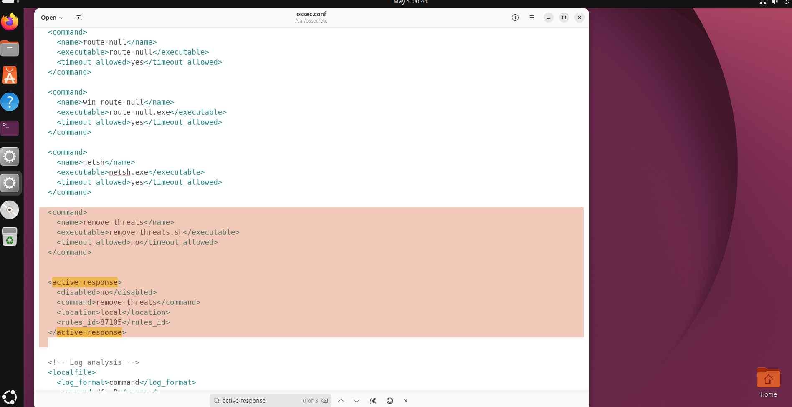
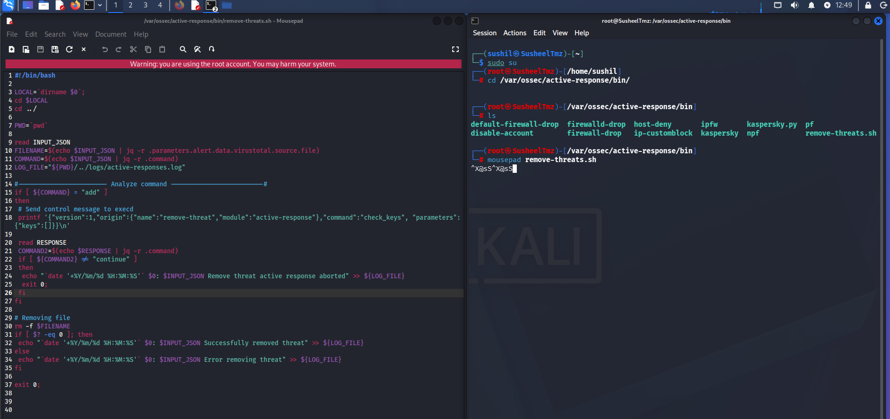
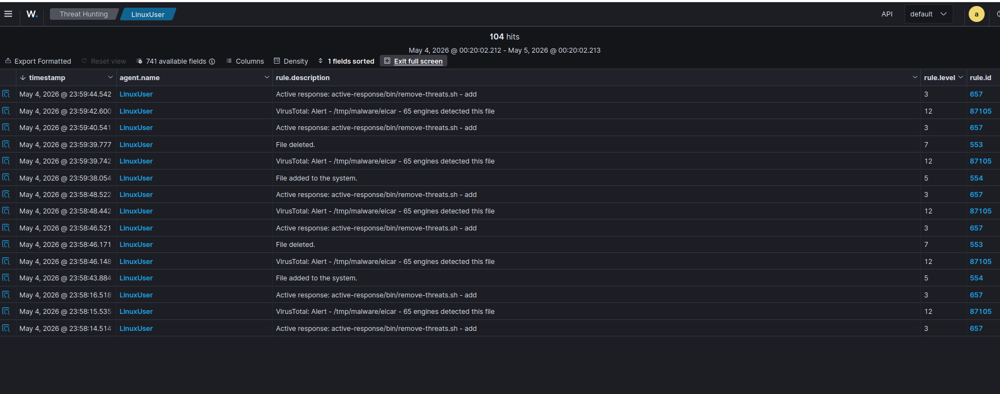
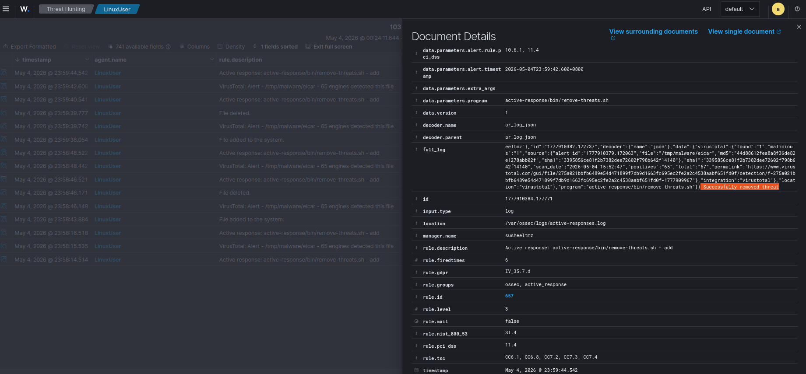

# Custom Wazuh Active Response — actual lab workflow

## Configuration evidenced by screenshots

The uploaded screenshots show Wazuh configuration in `/var/ossec/etc/ossec.conf` for a command named `remove-threats`, an executable called `remove-threats.sh`, `location` set to `local`, and a rule trigger of `87105`. The script is shown inside `/var/ossec/active-response/bin/`.

The Bash script reads Wazuh active-response JSON, extracts `.parameters.alert.data.virustotal.source.file` with `jq`, sends a `check_keys` control message to `wazuh-execd`, reads the `continue` response, and then invokes `rm -f` for the extracted path. It writes result messages to the active-response log.

**Important:** This describes the photographed implementation, not a general recommendation to delete files directly from alert-supplied paths. Unvalidated file paths and root privileges can cause data loss. A production implementation requires strict path allowlisting, independent validation, appropriate authorization, backup/evidence preservation, version-specific protocol checks, and testing.

## Observed alert sequence

In the provided Wazuh threat hunting screenshots on **4 May 2026**:

1. FIM event shows the EICAR test file under `/tmp/malware/eicar` was added (rule `554`).
2. VirusTotal integration reports an EICAR reputation alert with **65 detections** in the alert text (Wazuh rule `87105`).
3. Wazuh records execution of `active-response/bin/remove-threats.sh - add` (rule `657`).
4. The Active Response log contains the message **"Successfully removed threat"**.
5. FIM also records file deletion under the watched directory (rule `553`).

These screenshots establish an observed detection, enrichment and response sequence in the lab; they do **not** independently establish a precise under-two-second end-to-end duration.

## Original evidence

## SOC Level 1 takeaways

- Review agent identity, file path, raw alert and correlation timing before deciding on the action.
- Distinguish EICAR (a **harmless antivirus test file**) from genuine malware.
- Validate the effect with endpoint/FIM evidence; do not rely on a success string alone.
- Escalate destructive containment actions under established organizational playbooks.
